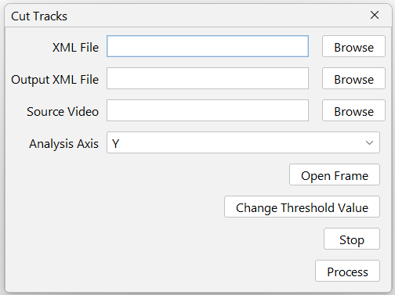

# Calculate Score Gradient

This feature trims TrackMate tracks from its XML file at a user-defined boundary line. 

After loading a source video frame (calibrated from the XML) and its matching TrackMate XML, the user drags a movable line - a threshold - and the plugin scans every track along the chosen axis for the first frame in which the animal crosses that line. 

Everything that happens after that crossing is discarded for that track, including frames where the animal returns to the other side, so each trajectory is cut monotonically at its first arrival. 

The pixel position of the line is converted to the XML's calibrated units before comparison, and the frame's calibration is validated against the XML first, so the cut is accurate for any pixel size or spatial unit. 

Edges, spot bookkeeping, and per-track summary fields (NUMBER_SPOTS, TRACK_STOP, TRACK_DURATION, mean X/Y location) are updated accordingly, and the pruned dataset is written to a new XML file of the user's choice.

## Interface
{ width="400em" }

## XML File
Only the **Trackmate's whole save file** can be used here.



## Output XML File
Choose the path to the output XML file.

## Analysis Axis
Choose which axis will be used to set the threshold to cut the tracks.



## Change Threshold Value
Allows the user to change the threshold value by clicking on the preview image.

## Stop
Stop changing max and min values.